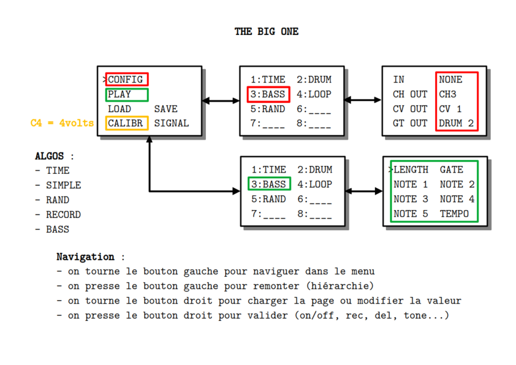

## PRÉSENTATION
Ce code permet de gérer un module qui possède des entrées et des sorties MIDI/CV/GATE. Les entrées et les sorties sont associées par des algorithmes.

## MODE D'EMPLOI
À la mise sous tension les leds s'allument à tour de rôle pendant que l'écran affiche pendant quelques secondes un message d'information suivi du numéro de version :

~~~~~~~
 THE BIG ONE
 by 
 CIYLab
 vx.y.z
~~~~~~~

La page principale permet les manipulations de base :

~~~~~~~
>CONFIG
 PLAY
 LOAD   SAVE
 CALIBR SIGNAL 
~~~~~~~

**Navigation** :

  - on tourne l'encodeur gauche pour naviguer dans le menu
  - on presse l'encodeur gauche pour remonter (hiérarchie)
  - on tourne l'encodeur droit pour charger la page CONF/PLAY ou modifier la valeur
  - on presse l'encodeur droit pour valider la modification

Une configuration consiste à choisir un algorithme, une entrée et une sortie parmi :

**In** :

  - NONE
  - MIDI (numéro de canal de 1 à 16)
  - CLOCK
  
**Out** :

  - NONE
  - MIDI (numéro de canal de 1 à 16)
  - GATE (CLOCK, DRUM, GATE 1,  GATE 2 et GATE 3)
  - CV (CV 1, CV 2, CV 3)
 
 **Remarque** :
 
 Les noms des cvs et des gates correspondent à la sérigraphie mais ils sont interchangeables.
 
**Algorithmes** :

  - ____ : ne fait rien (none)
  - SIMPLE : redirection du canal MIDI ou MIDI vers CV/GATE
  - RAND : générateur aléatoire
  - LOOPER : enregistrement d'une séquence
  - BASS : quelques notes (ligne de basse)
  - DRUM : rythmique (drum)
  - TIME : gestion de l'horloge

Le module est configuré par défaut :

|ID| IN    | OUT    | ACTION   | COMMENTS          |
|:-|:------|:-------|:---------|------------------:|
| 1| NONE |  CH1/CLOCK | TIME     | clock             |
| 2| NONE  | CH2/DRUM1 | DRUM | rythme euclidien  |
| 3| NONE  | CH3/CV1/DRUM2  | BASS  |  bass line |
| 4| CH1  | CH4/CV2/GATE1  | LOOP | séquenceur         |
| 5| NONE  |  CH5/CV3/GATE2   |  RAND    | notes aléatoires |
| 6| NONE  | NONE|   ____   | ne fait rien   |
| 7| NONE   |  NONE   | ____     |   ne fait rien  |
| 8|  NONE | NONE|  ____  | ne fait rien |

La calibration **CALIBR** permet de contrôler la justesse des notes sur un rack modulaire. Pour la calibration, la sortie CV1 doit fournir 4 volts. 

La page **PLAY** permet d'accéder aux paramètres de chacun des 8 modules.

La sortie **SIGNAL** assigne la led rouge à l'un des gates.

Il est possible de sauvegarder **SAVE** ou de charger **LOAD** une configuration. La validation se fait par pression de l'encodeur droit. Il y a 8 slots. Chaque slot contient les 8 modules y compris les éventuelles séquences du looper. Le premier slot **FACT** est modifiable mais ne peut pas être écrasé. On peut le sauvegarder sur un des autres 7 slots. Sur le même principe le premier module d'une configuration sera toujours **TIME** pour la gestion de l'horloge. Il n'y aura pas d'autre module disponible en première position.

**Reboot** : une pression longue sur l'encodeur de gauche redémarre le module.

**Program Change** : le module réagit aux messages PC (1 à 8) et affiche le module

**Control Change** : message CC (1 à 8) est celui du paramètre sur le canal midi correspondant

## DRUM

Module de rythme euclidien dual : on peut superposer deux rythmes.

~~~~~~~
>LENGTH  GATE
 BEATS   SHIFT
 beats   shift
 PITCH
~~~~~~~

* **LENGTH** le nombre de pas
* **GATE** durée d'un pas de 1 à 5
* **BEATS** nombre de pas actifs
* **SHIFT** décalage de la séquence
* **beats** nombre de pas actifs de la deuxième séquence
* **shift** décalage de la deuxième séquence
* **PITCH** hauteur de note sur la sortie MIDI si elle est configurée

## LOOPER

C'est un séquenceur pas à pas ou temps réel.

~~~~~~~
>LENGTH
 MODE
 RECORD  DELETE 
 GATE    MEMORY
~~~~~~~

* **LENGTH** en nombre de double-croche de 0 à 64
* **MODE** pas à pas ou temps réel
* **RECORD** par pression ON/OFF
* **DELETE** efface la séquence par pression
* **GATE** longueur de 1 à 5
* **MEMORY** permet de charger l'une des 8 séquences en mémoire

_Remarques_

* en mode pas à pas les notes sont des doubles-croches
* il est monophonique : une note (on/off) maximum par PPQN

## BASS

Module de ligne de basse de 1 à 5 notes (arpégiateur).

~~~~~~~
>LENGTH  GATE
 NOTE 1  NOTE 2 
 NOTE 3  NOTE 4 
 NOTE 5  TEMPO
~~~~~~~

* **LENGTH** le nombre de notes
* **GATE** durée d'un pas de 1 à 5
* **NOTE i** hauteur de la i-ème note
* **TEMPO** permet de ralentir la séquence jusqu'à la noire

## RANDOM

Générateur aléatoire de notes.

~~~~~~~
>LENGTH  GATE
 SCALE   KEY
 FREEZE  HUMAN
 MIN     MAX
~~~~~~~

* **LENGTH** longueur en doubles-croches
* **GATE** durée d'un pas de 1 à 5
* **SCALE** type de gamme
* **KEY** tonalité
* **FREEZE** gèle la séquence par pression
* **HUMAN** introduit des variations (octave, quinte)
* **MIN** et **MAX** fixe une plage de hauteurs

## SIMPLE

Comme son nom le suggère c'est un simple module de redirection essentiellement configuré pour ses entrées/sorties.

~~~~~~~
>MIN
 MAX
 TRANSP
 
~~~~~~~

* **MIN** et **MAX** filtre dans une plage de hauteur
* **TRANSP** changement de la hauteur de ce qui est joué
## TIME

Ce module essentiel  permet de gérer l'horloge et est présent par défaut dans toutes les configurations.

~~~~~~~
>BPM
 SPEED
 METER
 CHAOS
~~~~~~~

* **BPM** de 30 à 240 
* **SPEED** permet de ralentir ou accélérer la sortie d'horloge
* **METER** mesure à 3, 4 ou 5 temps
* **CHAOS** introduit de l'aléatoire dans la sortie de l'horloge

_Remarques_

* si TIME est configuré avec une sortie MIDI alors un métronome est activé sur le canal choisit

## DONNÉES TECHNIQUES

**Alimentation** :

* Bus Eurorack : 5v 42mA

**Dimensions** :

* largeur : 12HP
* profondeur : 45mm

**Librairies** :

* MIDI Library            5.0.2
* Versatile_RotaryEncoder 1.3.1
* U8g2                    2.36.19

**Plateforme** :

* STMicroelectronics:stm32 2.12.0
* arduino:renesas_uno:nanor4 1.6.0
