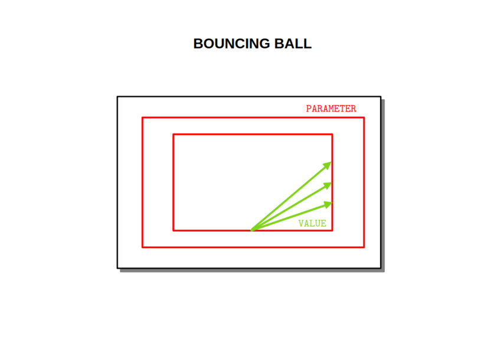

## PRÉSENTATION

Juste pour donner un exemple fun de ce qu'il est possible de faire avec le module MIDI Tools.

La suite décrit le code, pas l'usage : il suffit de tourner les deux pots.

## BALL

Gère la trajectoire de la balle = position (x, y).

À chaque impact une note est jouée. 

Les tempos sont constants sur chaque murs opposés mais pas synchronisés.

## DISPLAY

Gère l'affichage OLED :

- balle ponctuelle
- taille du cadre

## ENCODER

L'encodeur **PARAMETER** modifie l'angle de la trajectoire.

L'encodeur **VALUE** modifie la taille du cadre.

## MIDI

Le canal MIDI est 1 et les notes MIDI valent 24 et 48 (C2 et C4 ?)

## DONNÉES TECHNIQUES

**Alimentation** :

* Bus Eurorack : +12v 40mA

**Dimensions** :

* largeur : 12HP
* profondeur : 27mm

**Librairies** :

* SPI                     1.0
* Versatile_RotaryEncoder 1.3.1
* U8g2                    2.35.30
* Wire                    1.0

**Plateforme** :

* thinary:avr   1.0.0
